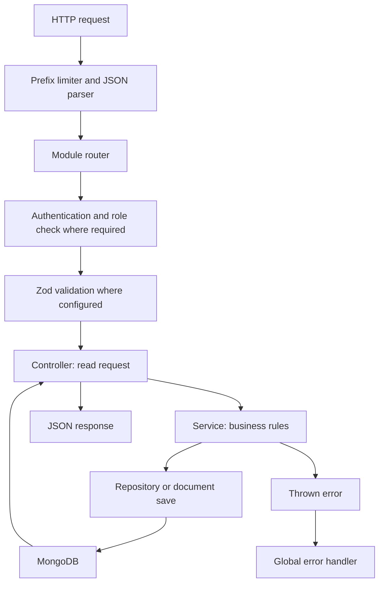

# Architecture and request lifecycle

## What the project runs

This is a TypeScript Express 5 API. MongoDB stores application records through Mongoose. Redis stores BullMQ email jobs, and Nodemailer sends them using Gmail transport. TypeScript compiles `src` into CommonJS JavaScript in `dist`; Node executes the compiled code.

The installed Socket.IO dependency is not wired into a realtime feature in the inspected application. A dependency in package.json does not by itself mean a feature exists.

## Startup and shutdown

[app.controller.ts](../src/app.controller.ts) loads `config/.env.dev` relative to the process working directory. `bootstrap()` creates Express, installs credentialed CORS with the CORS_ORIGINS allowlist, Helmet, and cookie-parser, validates cart limits, connects MongoDB, ensures cart indexes, initializes the order model, and starts the email queue/worker. It then mounts routers, installs a final 404 handler and global error handler, and listens on `PORT` or 4000.

JSON parsing is mounted per API prefix, not globally. Limits are auth 10 KB, products 1 MB, users 50 KB, categories 20 KB, cart 50 KB, orders 100 KB, and payments 10 KB. Each group also has an IP rate limiter. `/test` returns HTTP 200 with `{ "status": true, "message": "Hello World" }`; it is a simple response, not a dependency health probe.

[index.ts](../src/index.ts) catches startup failures. On SIGINT/SIGTERM it stops accepting HTTP requests, closes email work, disconnects MongoDB, and uses a 30-second shutdown deadline. The worker runs in the same application process.

## Request flow

Public routes skip authentication. Auth routes have their own ordering and endpoint limiters. Always read the actual router to establish middleware order.

## What each file means

| File suffix | Responsibility | Example |
| --- | --- | --- |
| `.routes.ts` | Connect an HTTP verb/path to middleware and controller | `router.patch('/items/:productId', ...)` |
| `.validation.ts` | Runtime input shape, allowed fields, ranges, defaults | Reject fractional cart quantities |
| `.dto.ts` | TypeScript input types, commonly inferred from Zod | `UpdateCartItemDTO` |
| `.controller.ts` | Extract body/params/user, call service, choose HTTP status and response | Pass `req.user._id` to cart service |
| `.service.ts` | Business behavior and coordination | Reject an unavailable product |
| `.repository.ts` | Mongoose queries and database operations | Find a cart by its owner |
| `.model.ts` | Stored fields, indexes, defaults, validators, hooks | Unique cart owner index |
| `.interface.ts` | TypeScript document shape | Cart item has product ID and quantity |
| `.authorization.ts` | Currently placeholder files; restrictions are defined in routers | ADMIN argument to `authentication()` |

A DTO disappears at runtime: it cannot validate an incoming network request. Zod validates the HTTP boundary; Mongoose validates persisted documents; service checks enforce rules involving other records. These are different jobs.

`req.body` is JSON, `req.params` holds path variables, `req.query` holds URL query values, and `req.user` is attached by authentication. A controller's `req.user!` is a TypeScript assertion relying on router middleware; it is not an extra authentication check.

## Example: replace a cart quantity

`PATCH /api/v1/cart/items/507f1f77bcf86cd799439011` with `{ "quantity": 2 }`:

1. Bootstrap routes `/api/v1/cart` to `cartRouter` after limiting and JSON parsing.
2. Router authentication verifies an access token and requires the USER role.
3. `cartProductIdSchema` validates the path and `updateCartItemSchema` validates the body.
4. `cartController.updateCartItem` passes authenticated user ID, product ID, and body to the service.
5. `cartService.updateCartItem` validates quantity and uses `mutate()` to load the owner's cart, find the line, check availability when appropriate, and change it.
6. `cart.save()` writes conditionally on the document version. A version conflict reloads and retries; repeated conflicts become 409.
7. `buildCartResponse()` retrieves current products, calculates totals, and returns a version.
8. The controller sends HTTP 200 with `{ success, message, data }`.

This is a quantity replacement. The `/increase` endpoint instead adds to the existing quantity.

## Responses and errors

Most catalog endpoints return `{ success: true, message, data }`. Auth often puts `user` and `tokens` directly beside `success`, while cart data directly contains `items`, `totalItems`, `subtotal`, and `version`. Do not assume all modules share one response shape.

Express 5 propagates rejected async handlers to the error middleware. Application exceptions carry a status code: 400 input/business rejection, 401 authentication failure, 403 forbidden role/action, 404 missing or hidden record, 409 conflict. Rate limiters return 429. Email enqueue failures use 503. The global handler uses `statusCode || 500` and returns `message`; stack and cause are included only when `MODE=DEV`. Errors without a mapped status can therefore become 500.

## Where to make a change

To add an API, define its schema/DTO, service behavior, controller, and route; add repository methods when database access needs them. Add model fields only when data must persist. Write tests for behavior, including authorization and rejected inputs. If a service helper has no mounted route, it is not a callable API. See the module guides for concrete mappings.

