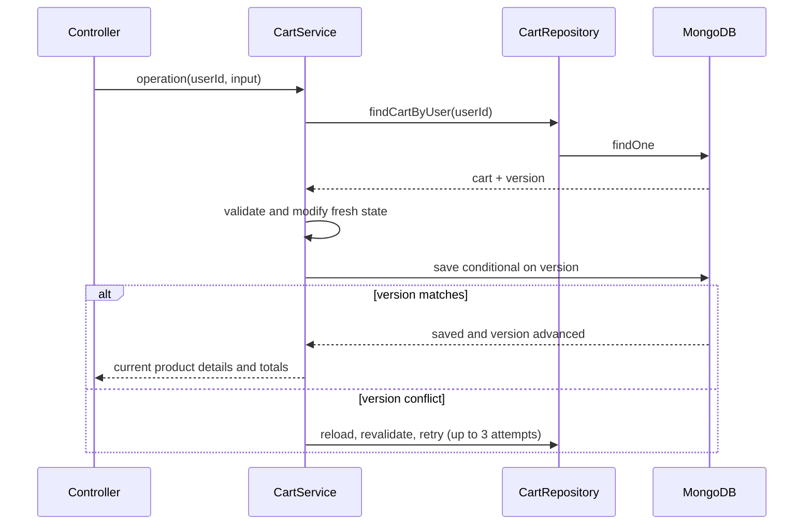

# Cart module: API walkthrough

Source: [routes](../src/Modules/cart/cart.routes.ts), [validation](../src/Modules/cart/cart.validation.ts), [DTOs](../src/Modules/cart/cart.dto.ts), [controller](../src/Modules/cart/cart.controller.ts), [service](../src/Modules/cart/cart.service.ts), [limits](../src/Modules/cart/cart.config.ts), [repository](../src/DB/repository/cart.repository.ts), [model](../src/DB/models/cart/cart.model.ts).

Prefix: `/api/v1/cart`. Every route requires an access token with the USER role. The owner is always `req.user._id`; callers do not submit a user ID. An ADMIN token does not satisfy this router's USER-only role list.

## Every route

All successful operations return HTTP 200 with `{ success: true, message, data }`. Controller methods call service methods with the same names.

| Method and suffix | Validation/input | Service behavior |
| --- | --- | --- |
| GET `/` | No body | `getCart(userId)` -> `findCartByUser`; absent cart returns an empty response without creating a document |
| POST `/items` | `addCartItemSchema`: productId, quantity default 1 | `addCartItem` -> `mutate(..., create=true)` -> active product lookup, stock/limits check, append or increment line |
| PATCH `/items/:productId` | ID schema + `updateCartItemSchema`; quantity required | `updateCartItem` -> find existing line -> replace its quantity |
| PATCH `/items/:productId/increase` | ID + `adjustCartItemSchema`; quantity default 1 | `increaseCartItem` -> `adjustCartItem(..., decrease=false)` -> add quantity |
| PATCH `/items/:productId/decrease` | ID + adjustment schema; quantity default 1 | `decreaseCartItem` -> `adjustCartItem(..., decrease=true)` -> reduce quantity or remove a line at one |
| DELETE `/items/:productId` | ID schema | `removeCartItem` -> find line -> remove it |
| DELETE `/clear` | No body | `clearCart` -> replace items with an empty array |

Mutation routes except add require an existing cart. Missing cart or item returns 404. Remove and clear do not delete the cart document itself.

## Add versus replace versus adjust

Add body: `{ "productId": "507f1f77bcf86cd799439011", "quantity": 2 }`.

If the line already contains three units, adding two results in five. PATCH on the line with `{ "quantity": 2 }` replaces three with two. PATCH `/increase` with that body results in five. PATCH `/decrease` results in one.

Decrease has a specific existing rule: if current quantity is one, it removes the line even when the requested decrease is greater than one. If current quantity exceeds one and the resulting quantity would be below one, it returns 400. Use DELETE to remove the line explicitly.

Quantity inputs must be positive integers within `CART_MAX_QUANTITY`. The service checks resulting cumulative quantities on additions/increases, so repeated small additions cannot bypass the cap. `CART_MAX_ITEMS` limits distinct stored product lines. Defaults are 100 units per product and 50 distinct lines. Configuration is read lazily after dotenv and validated at startup.

## Atomic persistence and concurrent requests



`mutate()` centralizes this process. The cart schema enables Mongoose `optimisticConcurrency`, so a document save is conditional on `__v`. This prevents two readers from silently overwriting each other's modifications. A `VersionError` retries using a new read; after three attempts it becomes HTTP 409. Network or other ambiguous errors are not blindly replayed.

For a missing cart, `createCart()` uses an upsert with `$setOnInsert`. A unique user index allows only one cart per user. If another request wins an insert race and MongoDB reports duplicate key, the repository fetches that winner. Startup ensures the index exists before accepting traffic.

## Stock and unavailable products

Adds/increases check current product activity and stock, but these checks reserve nothing. Another customer can purchase stock before checkout. Checkout must validate again and deduct atomically.

Reductions and removal work even when the product was deleted, deactivated, or is now out of stock. An absolute quantity update checks product availability/stock only when the requested quantity is at least the current quantity. This allows the user to reduce an unavailable line.

`buildCartResponse()` loads each referenced product. Deleted/inactive products remain as a minimal product ID with `available: false`, original quantity, and zero subtotal. They count toward the stored line limit until removed. An active product with insufficient stock is also marked unavailable, but its subtotal still uses current price times quantity. Therefore cart subtotal is a current display calculation, not a promise that every line can be bought.

## Response data

```json
{
  "items": [{
    "product": { "_id": "507f1f77bcf86cd799439011", "name": "Example Phone", "price": 500, "stock": 10, "isActive": true },
    "quantity": 2,
    "available": true,
    "subtotal": 1000
  }],
  "totalItems": 2,
  "subtotal": 1000,
  "version": 3
}
```

Active product objects also include slug and images. `totalItems` sums quantities, not distinct lines. A cart with two products at quantity three has totalItems six. `version` comes from the cart document; an absent cart responds with version zero. Current prices are fetched for each response, not stored in the cart.

The version and reviewed unit prices are sent to [checkout](ORDER.md). Current cart mutation endpoints do not accept an expected version from the client; their version handling protects database read/write races internally. Checkout explicitly requires the client's reviewed version.

Tests: `tests/cart.service.test.cjs` exercises service rules and conflict handling; `tests/cart.integration.test.cjs` verifies actual database races and rollback when `MONGO_TEST_URI` is supplied. See [deployment notes](CART.md).
