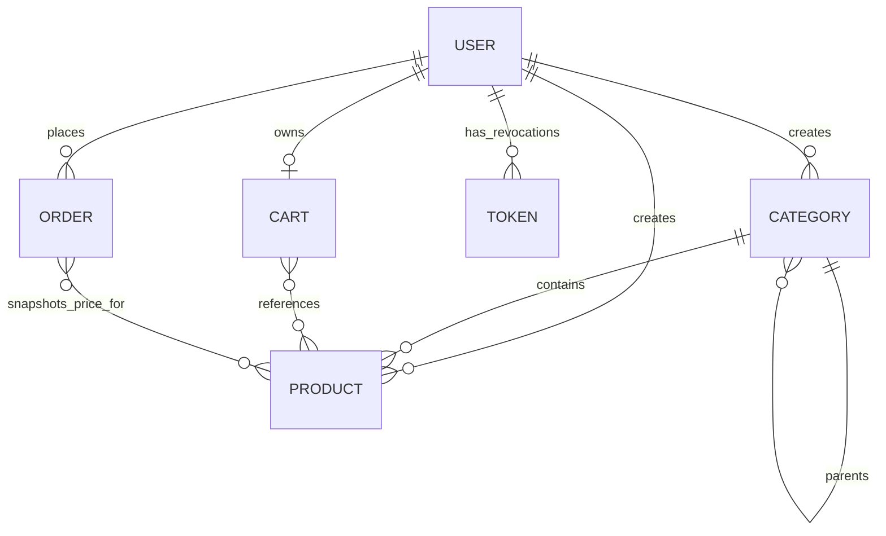

# Database, models, and repositories

[connection.ts](../src/DB/connection.ts) reads `MONGO_URI`, opens Mongoose with a five-second server-selection timeout, and logs the connected host. Startup fails if configuration or connection fails. Checkout additionally needs transaction support.

## Collections and relationships

These are logical references using ObjectIds, not SQL foreign-key constraints. MongoDB does not automatically delete cart lines or reject product deletion because an order references a product. Service rules decide how to handle missing references.

| Model | Stored data | Important behavior |
| --- | --- | --- |
| [User](../src/DB/models/user/user.model.ts) | Identity, password hash, contact data, addresses, role, OTP states, tokenVersion | Unique email; hidden secret fields; username virtual; slug/hash/email hooks |
| [Token](../src/DB/models/token/token.model.ts) | Revoked jti, expiresAt, userId | Unique jti; TTL index removes expired revocation records |
| [Category](../src/DB/models/category/category.model.ts) | Name, unique slug, optional description/image/parent, isActive, sortOrder, createdBy | Parent/activity sorting indexes; timestamps; versionKey disabled |
| [Product](../src/DB/models/product/product.model.ts) | Catalog fields, unique slug/SKU, price/compareAtPrice, stock, images, category, isActive, createdBy | Stock/price validators; category/activity/price indexes; versionKey disabled |
| [Cart](../src/DB/models/cart/cart.model.ts) | User and embedded product/quantity lines | Unique user; integer quantities; item subdocuments have no separate IDs; optimistic concurrency |
| [Order](../src/DB/models/order/order.model.ts) | User, embedded product/quantity/unitPrice lines, total, status | User index; timestamps; status defaults to placed |

`createdAt`/`updatedAt` are generated by Mongoose timestamps on these models. The Order model does not currently have a separate `.interface.ts`; its schema supplies inferred types.

## Interface, document, and model

An interface such as `ICart` describes data fields to TypeScript. A hydrated document adds Mongoose behavior, including `.save()`, `.set()`, change tracking, and version state. A model such as `CartModel` provides collection-level queries such as `findOne()` and `updateOne()`.

`.exec()` executes a Mongoose query and returns its promise. `.select('+password')` explicitly requests a field hidden by the schema. `.session(session)` joins a transaction. An ObjectId is converted to a string for HTTP output/comparison and reconstructed from validated request IDs for queries.

## Shared repository

[db.repository.ts](../src/DB/repository/db.repository.ts) is a generic wrapper over an injected Mongoose model. Specialized repositories extend it but also define domain-specific methods.

| Helper | Purpose and current detail |
| --- | --- |
| `create`, `insertMany` | Insert arrays of records |
| `find`, `findOne`, `findById` | Read with projection and optional population; these helpers currently only apply the populate part of the supplied options |
| `paginate` | Count and fetch a page; returns limit, count, pages, currentPage, docs |
| `findOneAndUpdate` | Pass update/options through and optionally populate; return behavior depends on caller options |
| `updateOne` | Adds `$inc: { __v: 1 }`; currently replaces any caller-supplied `$inc` object |
| `deleteOne`, `deleteMany`, `findOneAndDelete` | Delete matching records with their different return shapes |

These helpers are not interchangeable. In particular, the base `updateOne` behavior means callers cannot assume arbitrary increment operations are preserved. Cart/checkout concurrency uses document saves or explicit model updates rather than changing shared repository behavior.

## Specialized repositories

- [User repository](../src/DB/repository/user.repository.ts): normal and secret-field lookups, createUser, guarded confirmation-code issuance/consumption, attempt counters, password-reset issuance, password changes, and tokenVersion increments. Conditional predicates bind updates to the observed code/hash/version.
- [Token repository](../src/DB/repository/token.repository.ts): injects TokenModel into the base wrapper; token utilities create/look up revoked IDs through it.
- [Category repository](../src/DB/repository/category.repository.ts): category queries, paginated public lookup/count, parent/active lookups, create/update/delete, and child-existence checks. Many active-only helper methods exist even when services share a more general public-list implementation.
- [Product repository](../src/DB/repository/product.repository.ts): ID/slug/SKU queries, filtered listing/counting, category lookup, create/update/delete, existence checks, and grouping products by category.
- [Cart repository](../src/DB/repository/cart.repository.ts): find by owner, concurrent-safe create/upsert with duplicate recovery, and delete by owner. Public clear empties the document; it does not call deleteCartByUser.
- [Order repository](../src/DB/repository/order.repository.ts): owns the multi-collection checkout transaction. It is a dedicated class rather than a subclass of the generic repository.

## Hooks versus query updates

`user.save()` runs document validation and pre/post-save hooks. This is why registration can pass a plaintext password into createUser and receive hashing plus confirmation enqueue behavior. In contrast, `updateOne()`/`findOneAndUpdate()` do not run the same document pre-save hook. Password-change/reset services therefore hash explicitly before passing an atomic update to the repository. Do not pass an already hashed password through a path that hashes modified document passwords again.

The user serializer removes sensitive password/OTP fields; most sensitive fields are also excluded from normal queries. Controllers return explicit safe profile/login objects rather than relying only on raw-document serialization.

## Three different version concepts

- Cart `__v` protects a specific cart document from lost updates and identifies the cart reviewed at checkout.
- User `__v` is used by certain guarded operations, such as password-reset code issuance; it is not the session token version.
- User `tokenVersion` is embedded in JWTs and incremented to invalidate sessions. Logging out everywhere changes this field, not the cart version.

Category/Product disable the default version key. Their ordinary updates do not inherit cart optimistic concurrency.

## Atomicity boundaries

A guarded single-document update is atomic for that document. Checkout uses a transaction because inventory, order creation, and cart clearing must succeed together. Category ancestry checks and ordinary catalog service checks span separate reads/writes. User save plus Redis enqueue also spans independent systems. Different modules therefore have different concurrency guarantees; a transaction in one module does not protect the whole application.
