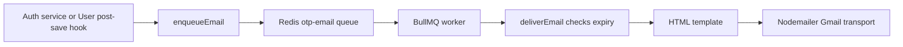

# Shared middleware, security, and background work

## Validation middleware

[validations()](../src/Middlewares/validation.middlewares.ts) receives an object with optional `body`, `params`, `query`, and `headers` schemas. It runs Zod safeParse on each supplied section, collects errors, and throws `BadRequestException('Validation Error', { cause })` if any section fails.

If all sections pass, it writes parsed output back to the request. This preserves numeric conversions, normalized strings, and default quantities. It uses Object.defineProperty because Express 5 exposes query through a getter. Controllers therefore receive parsed query values rather than raw strings.

Some module schemas are already section maps, such as `signupSchema = { body: ... }`. Others are plain Zod objects, such as addCartItemSchema, and routes wrap them as `{ body: addCartItemSchema }`. Passing the wrong shape would skip or misapply validation.

[generalFields](../src/Middlewares/validation.fields.ts) provides email normalization, password requirements, six-digit OTP validation, ObjectId checks, names, logout flags, and a generic file schema. The presence of a file schema does not create an upload endpoint; product APIs currently accept image URLs.

## Authentication and authorization

[authentication()](../src/Middlewares/authentication.middlewares.ts) requires an Authorization header, calls decodedToken(), checks the current database user's role against an optional allowed-role list, and attaches user/decoded claims to the request. No role list means any successfully authenticated role accepted by token decoding; a nonempty list must contain the user's role.

[token.ts](../src/Utils/security/token.ts) parses `user <JWT>` or `admin <JWT>`, chooses the appropriate access/refresh secret, verifies the token, validates required claims, loads the user, compares tokenVersion, checks credential-change time, and checks the token revocation collection. Refresh can deliberately allow a revoked-token result so its service can detect reuse and invalidate all sessions.

The middleware itself does not perform a general frozen-account check. Login and refresh explicitly check `freezedAt`. Likewise, timestamp checks depend on which fields a lookup selects. Read the specific service/repository path before assuming a security check applies to every operation.

[authenticated-request.d.ts](../src/Utils/types/authenticated-request.d.ts) extends Express request types for `req.user` and `req.decoded`. It supplies types, not runtime authentication.

[developmentOnly](../src/Middlewares/development.middlewares.ts) exposes the test-revoke route only for MODE=DEV outside NODE_ENV=production. Other module `.authorization.ts` files are currently placeholders; router middleware enforces roles.

## Errors

[error.response.ts](../src/Utils/response/error.response.ts) defines ApplicationException and specific 400/401/403/404/409 subclasses. The global error handler sends the exception's statusCode or 500 with a message. MODE=DEV includes stack and cause; otherwise those properties are omitted in JSON.

Rate-limit responses have their own `{ status: false, message }` shape. Final unmatched-route responses also use `status: false`. API clients should inspect HTTP status rather than assuming every failure uses `success: false`. Raw library errors without a mapped status may become 500; not every Mongoose/JWT exception is translated.

## Rate limiting

[rate-limit.ts](../src/Utils/middleware/rate-limit.ts) defines separate per-IP counters. All durations are 15 minutes unless shown otherwise.

| Limiter | Requests/window | Applied to |
| --- | --- | --- |
| authLimiter | 30 | All auth endpoints together |
| registerLimiter | 5 | Registration |
| loginLimiter | 5 | Login |
| otpLimiter | 5 / 10 minutes | Confirm email |
| resendEmailOTPLimiter | 3 | Resend confirmation |
| forgotPasswordLimiter | 5 / 10 minutes | Forgot password |
| resetPasswordLimiter | 5 / 10 minutes | Reset password |
| productsLimiter / categoriesLimiter | 300 each | Catalog prefixes |
| usersLimiter | 100 | Users prefix |
| cartLimiter | 150 | Cart prefix |
| ordersLimiter | 60 | Orders prefix |
| paymentsLimiter | 30 | Payments prefix |

An auth request can consume both the prefix budget and its endpoint budget. These are IP counters, separate from account OTP attempt/send counters persisted in MongoDB. No shared external rate-limit store is configured in this file.

## Hashing, OTP generation, and monitoring

[hash.ts](../src/Utils/security/hash.ts) wraps bcrypt hash/compare; salt rounds come from SALT_ROUNDS. [generateOTP.ts](../src/Utils/generateOTP.ts) uses crypto.randomInt and pads to six characters, preserving leading zeros.

[otp-monitor.ts](../src/Utils/security/otp-monitor.ts) logs threshold crossings at attempt three and the configured attempt limit. Logs include flow, user ID, IP, timestamp, and attempt count, but no password, email, or OTP. The attempt counts come from conditional database writes rather than an in-memory guess count.

[logout.ts](../src/Utils/security/logout.ts) exports only an `only`/`all` enum used by shared validation. Current logout behavior is implemented by the two Auth routes/services, not a separate logout worker. A similar enum also exists in token.ts.

## Email queue flow

[email.queue.ts](../src/Utils/email/email.queue.ts) supports `confirmEmail` and `resetPassword` jobs carrying recipient, username, plaintext OTP, and expiration timestamp. The API waits for enqueue acknowledgement, not SMTP completion. Queue failure becomes HTTP 503.

The worker uses concurrency three. Jobs get five total attempts with exponential backoff starting at five seconds. SMTP errors propagate so BullMQ can retry. Expired codes throw UnrecoverableError and are not retried. Completed jobs are removed immediately; failed jobs have age/count retention limits. Redis connections are lazy and configured from REDIS_URL, including rediss TLS support. Consumer connections are allowed to wait/retry; producer behavior is bounded to avoid silently buffering request work indefinitely.

[send.email.ts](../src/Utils/email/send.email.ts) lazily caches a Gmail Nodemailer transporter using NODEMAILER_EMAIL and NODEMAILER_EMAIL_PASSWORD, sets connection/greeting/socket timeouts, and sends from the E-Commerce display name. [verify.email.template.ts](../src/Utils/email/verify.email.template.ts) renders the code and event-specific text.

MongoDB and Redis do not share a transaction. A persisted user/code may exist after an enqueue failure; delivery can also be duplicated after a crash around SMTP acknowledgement. A replacement code invalidates the previous hash in MongoDB, even if an old queued message is later delivered. See [EMAIL_QUEUE.md](EMAIL_QUEUE.md) for durability and recovery details.

Refresh credentials now arrive through an HttpOnly cookie; access credentials still use the Authorization header. See [cookie transport and CORS](AUTH_COOKIES.md).
